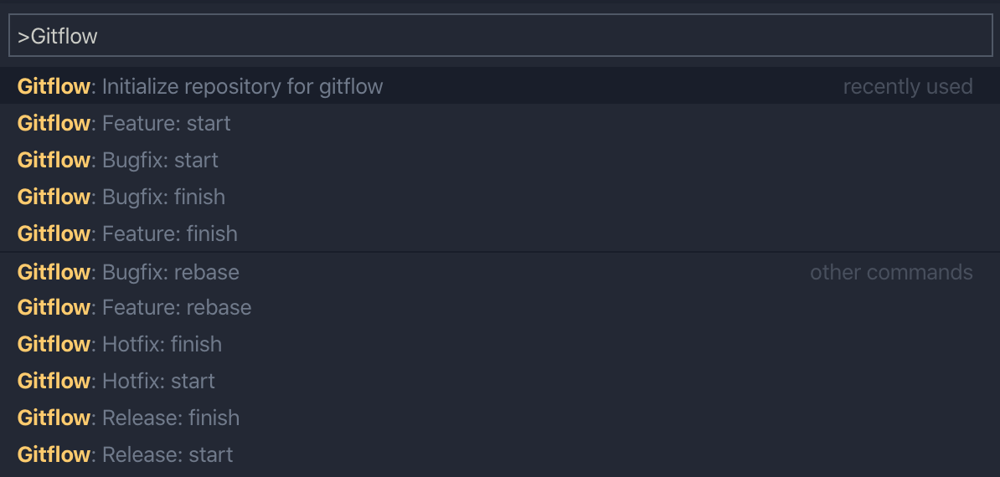
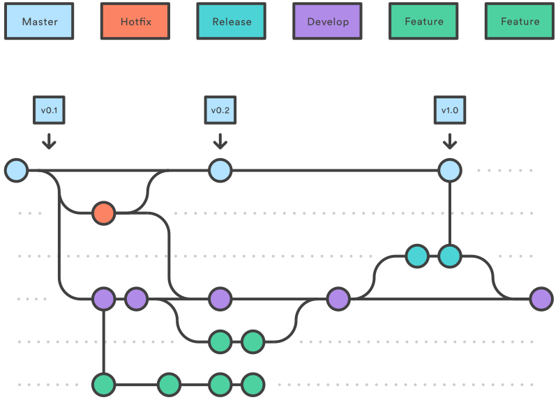

# Gitflow integration for Visual Studio Code

   

This extension provides integration and support for [gitflow](http://nvie.com/posts/a-successful-git-branching-model/). It is based on [this gitflow implementation](https://github.com/nvie/gitflow) and intends to be fully compatible with it.

## ✨ What's new

* Card integration for branch naming (feature, bugfix, hotfix, release, support, task) with customizable template
* Commands and configuration for task management in the Gitflow workflow
* Settings for offline work and optional sync checking

## 🚀 Features

* Workspace support 🥳
* Squash feature during merge (default: false)
* Fast-forward merge feature into develop branch if only 1 commit
* Better error messages
* Card-based branch naming for all branch types
* Task management commands and configuration
* Offline mode and sync check options
* Improved codebase structure

## 📒 Todoist

* Setting to allow fast-forward merge feature
* Add gitflow funtions into SCM

## 🏁 Getting Started

Firstly, you always have to *Initialize repository for gitflow* for your repository, then follow the command prompts and accept the defaults or write your release/production branch name.

If you already have gitflow set up for your repository, just start execcuting gitflow commands from the Command Palette!

## 🎬 Summary

1. A `develop` branch is created from `master`

2. A `release` branch is created from `develop`

3. `Feature` branches are created from `develop`

4. When a `feature` is complete it is merged into the `develop` branch

5. When the `release` branch is done it is merged into `develop` and `master`

6. If an issue in `master` is detected a `hotfix` branch is created from `master`

7. Once the `hotfix` is complete it is merged to both `develop` and `master`

## 📝 Note

Forked from [vector-of-bool/vscode-gitflow](https://github.com/vector-of-bool/vscode-gitflow).

Icons made by [Flat Icons](https://www.flaticon.com/authors/flat-icons) from [www.flaticon.com](https://www.flaticon.com/)
